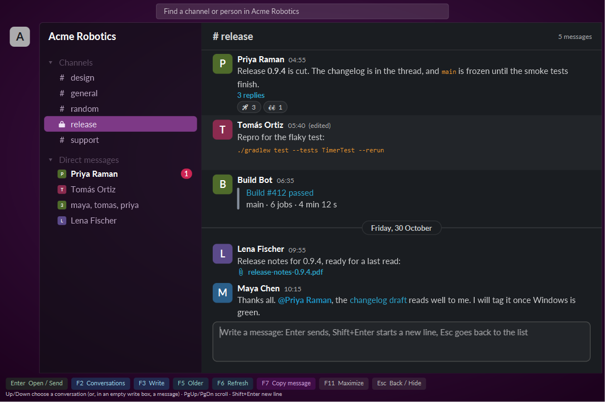

<p align="center"></p>

# slackfx

A small chat client for Windows, and a command line for the same workspace, in one program: `slackfx` with no arguments is the client, `slackfx <verb>` is the command line. Both act as you, through an app you create in your own workspace, so there is no browser to keep open and nothing to scrape.

Status: 0.2, early. Windows only. Organisation [fxslack](https://fxslack.github.io). slackfx is an independent project and is not affiliated with Slack or Salesforce; "Slack" is their trademark.



The screenshots show an invented workspace. `slackfx --demo` opens the same one on your machine, with no login and its own state folder, so you can look around before setting anything up.

## Why

The official desktop app runs several processes and holds around a gigabyte of RAM. **slackfx** is one process: a tray icon that stays resident, and a chat window that opens when you want it. Measured on one machine in October 2026, the official app used about 1,000 MB a half minute after a cold start; slackfx used about 200 MB with its window open and a channel loaded, and about 40 MB a couple of minutes after the window was closed.

**The command line** reads and writes your workspace from a terminal or a script, and is made to be driven by AI coding agents. Reads are free. **Nothing that changes anything goes out without a person.** Every write (`send`, `edit`, `delete`, `react`, `mark`, scheduling, and anything sent with `raw`) goes through the running client, which shows a window with exactly what is about to happen and waits for the person to approve it with F2. If the client is not running, the write is refused. Anyone who really wants writes to go straight through can put `"require_approval": false` in `app-config.json`.

## What it does

### The client

- Lives in the tray. The window opens from the tray icon and hides when closed; closing it gives the memory back.
- Channels, group chats and direct messages in one list, with a filter. Channels A-Z, then conversations by latest activity. Unread conversations are bold with a count.
- Messages with their formatting: bold, italic, strike, code and code blocks, quotes, links, mentions, dates, reactions, attachments and files.
- New messages arrive within a second, over a live socket connection. A notification appears for a direct message, a group chat or an @-mention you are not already looking at.
- Write in the window and send with Enter.
- Keys, all single keys: Enter open or send, F2 conversations, F3 write, F5 older, F6 refresh, F7 copy the message, F11 maximise, Esc back or hide. The footer lists them.
- Not built yet: opening a thread, downloading a file, editing or deleting from the window.

### The command line

```
slackfx auth            store an account
slackfx accounts        list accounts; the active one is starred
slackfx use <account>   make an account the active one
slackfx whoami          ask the service who you are
slackfx channels        the channels you are in (or all of them with --all)
slackfx users           people, filtered by name, handle or email
slackfx history         read a channel, oldest first
slackfx thread          read a thread
slackfx search          search messages across the workspace
slackfx export          save a whole channel: messages, thread replies, files
slackfx members         who is in a channel
slackfx file            download a file, or read a canvas
slackfx send            post a message, a thread reply, or a scheduled message
slackfx edit, delete    change or remove one of your messages (a dry run unless --yes)
slackfx react           add or remove an emoji reaction
slackfx scheduled       list or cancel scheduled messages
slackfx mark            mark a channel as read
slackfx raw             call any Web API method (reads at once, anything else needs approval)
slackfx update          install the newest release
```

Every verb has `--help`. Examples:

```
slackfx history "#general" -n 20
slackfx search "release notes"
slackfx send "#general" "Build is green"          a dry run: prints what would be posted
slackfx send "#general" "Build is green" --yes    asks a person in the client, then posts
slackfx send "#general" "Following up" --thread 1760000000.123456 --yes
```

## Set it up

1. Create the app, once. At [api.slack.com/apps](https://api.slack.com/apps) choose **Create New App**, then **From a manifest**, pick your workspace and paste [`docs/app-manifest.json`](docs/app-manifest.json). It asks for user-token scopes only (it reads and posts as you) and turns on Socket Mode.
2. Under **OAuth & Permissions** choose **Install to Workspace** and allow it. Copy the **User OAuth Token** (it starts with `xoxp-`).
3. Under **Basic Information**, **App-Level Tokens**, generate one with the `connections:write` scope. Copy it (it starts with `xapp-`). It is what lets slackfx receive messages live; without it slackfx polls the open conversation instead.
4. Save both in `app-config.json` in the app's folder, `%USERPROFILE%\fxslack\slackfx\` (`~/fxslack/slackfx/`):

   ```json
   {
     "user_token": "xoxp-...",
     "app_token": "xapp-..."
   }
   ```

5. Run `slackfx auth --app`, then `slackfx whoami`. Start `slackfx` for the tray and the window.

An admin of your workspace may need to approve the app first. The tokens give whoever holds them access as you, so keep that file private (it is never part of this repository, and `.gitignore` lists it).

### Without creating an app

`slackfx auth` with no option reads the session of a workspace tab that is already logged in, in a browser that [cdpgate](https://github.com/cdpai/gate) runs. That session token rotates and needs the browser's cookie, so the app token above is the better route; this one is for workspaces that do not let you install an app.

## Install

Download `slackfx.exe` from the [latest release](https://github.com/fxslack/slackfx/releases/latest) and run it. It needs Java 25 or later. The exe fetches its program file from the same release and checks it against a checksum built into it. One exe is both the client and the command line; put it on your PATH to use the verbs.

## Updates

The client checks for a newer release shortly after it starts and then every 24 hours. When there is one it asks: a window says which version is out, F2 updates and restarts it in the tray, Esc leaves it for the next check. Nothing is downloaded or replaced without that answer. The command line mentions a newer release at most once a day, on stderr, and `slackfx update` installs it (`slackfx update --check` only looks). The checking and the swap are done by [jr](https://github.com/jarrunner/jr), the launcher that made the exe.

## Build from source

Needs JDK 25 and Maven.

```
mvn package          the jars, in core/ and app/ under target/
mvn verify           also the exe, in app/target/jr
```

`mvn -Djr.installDir=<folder> verify` copies the exe into a folder on your PATH. `mvn -Djr.source=url verify` builds the release exe, which fetches its jar from the GitHub release.

Every dependency resolves from Maven Central, with one exception: `leasegate-frame` is used at its 0.3 snapshot, from the Central snapshot repository that the parent pom already names. A build from an empty local repository works with no extra steps.

## Where things are

Everything slackfx keeps is in `%USERPROFILE%\fxslack\slackfx\`: `app-config.json` (the tokens), `sessions.json` (stored accounts), `cache/` (names, pictures, the last conversation list), `run/` (the log, and where slackfx listens). slackfx listens on `127.0.0.1` only, with a random token kept in your user profile.

## Licence

Apache-2.0. Lato (the font in the window) is by Łukasz Dziedzic, under the SIL Open Font Licence; its licence is beside the font files.
